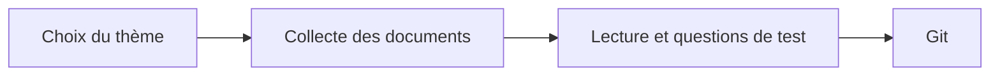

# WebCognitive Engine : Étape 1

**Antoine Jarnoux, M1 Informatique, Paris 8**

## Thème

L'histoire d'Internet (1960-2000) : ARPANET, TCP/IP, le Web, et le réseau français Cyclades.

## Démarche

## Corpus : 41 documents

| Format | Nombre | Exemples |
|---|---|---|
| PDF | 10 | Articles de Cerf et Kahn (1974), Clark (1988) |
| TXT | 11 | RFC 1, RFC 791 (IP), RFC 793 (TCP) |
| HTML | 12 | Internet Society, W3C, CERN |
| DOCX | 8 | Notes sur ARPANET, le Minitel |

## Questions de test (exemples)

- Qui a écrit la RFC 1 ? → Steve Crocker, en 1969
- Quand ARPANET est-il passé à TCP/IP ? → Le 1er janvier 1983

## Suite

Étape 2 : extraire et nettoyer le texte de tous les documents.
